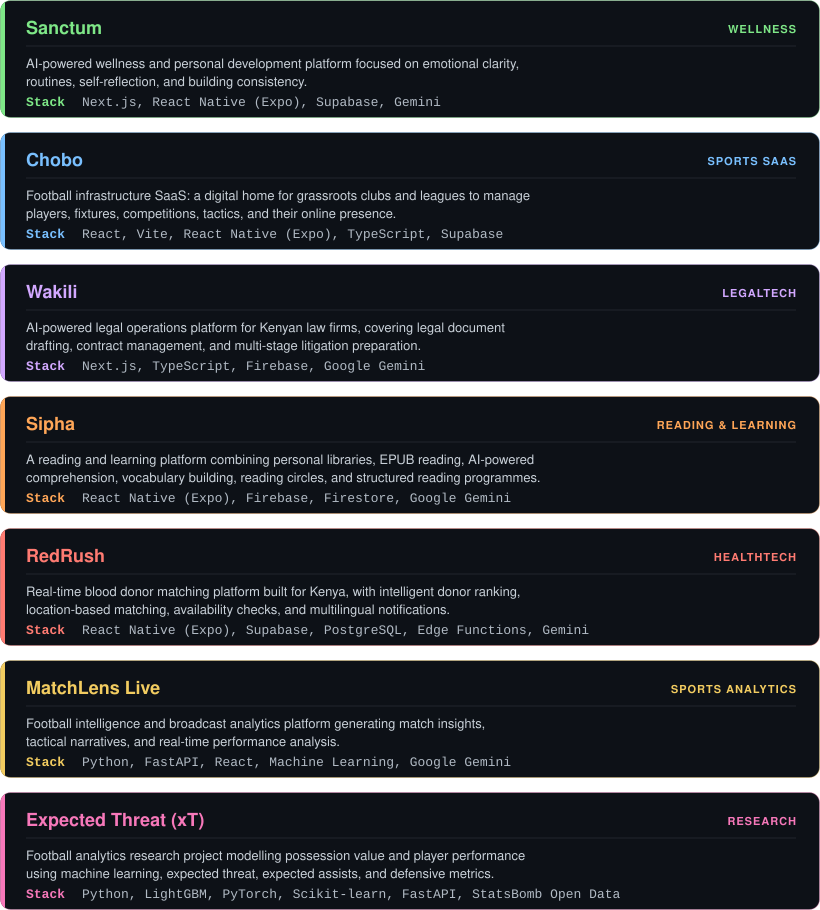

  

---

## Turning Code into Solutions, Solutions into Impact

I'm driven by the challenge of taking a raw idea, shaping it into working code, and refining it until it makes a real-world difference. I build several AI and SaaS products at once as a solo founder, and I'm deep-diving into cybersecurity to keep what I ship safe and resilient.

I treat bugs like plot twists: unexpected, but they make the story better.

## What I'm Building

  

 

Most of these projects are independently developed, with a focus on solving practical problems through software, AI, and thoughtful product engineering.

## Tech Stack

**Frontend & Mobile** 

**Backend & Data** 

**AI & Machine Learning** 

**Tools** 

## GitHub Stats

  
  

  

