  

---

## Turning Code into Solutions, Solutions into Impact

I'm driven by the challenge of taking a raw idea, shaping it into working code, and refining it until it makes a real-world difference. I build several AI and SaaS products at once as a solo founder, and I'm deep-diving into cybersecurity to keep what I ship safe and resilient.

I treat bugs like plot twists: unexpected, but they make the story better.

## What I'm Building

| Project | What it is | Stack |
| --- | --- | --- |
| **[Sanctum](https://sanctumental.com)** | AI-powered wellness platform | Expo mobile + web |
| **Wakili** | AI litigation prep for Kenyan lawyers | AI / LLM |
| **FootballOS** | "Shopify for football clubs" SaaS | React Native + React |
| **Art Soko** | Art marketplace | Next.js + Convex |

## Tech Stack

**Frontend & Mobile** 

**Backend & Data** 

**AI & Security** 

**Tools** 

## GitHub Stats

  
  

  

